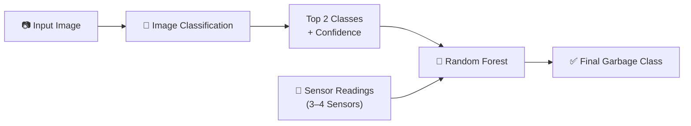

# 🧠 Model Training & Evaluation

### Smart Waste Segregation Project ♻️

This folder contains the training notebooks of the deep learning models developed for our **Smart Waste Segregation System**.

The main objective was to build an AI-based system capable of identifying and classifying garbage into four predefined categories using image classification, while exploring the possibility of integrating sensor-based classification.

---

## 🎯 1. Proposed AI Architecture

Initially, we planned to develop a hybrid **Deep Learning + Machine Learning architecture** consisting of two stages:

**Stage 1: Image Classification**

- An input garbage image would be processed by a deep learning model.
- The model would predict probabilities for all four garbage categories.
- The top 2 highest-confidence classes and their confidence scores would be extracted.

**Stage 2: Sensor-Based Classification**

- The confidence scores of the top 2 predictions would be combined with approximately 3–4 sensor readings.
- These combined inputs would be passed to a **Random Forest ML model**.
- The Random Forest model would make the final garbage classification based on the combined information.

### Proposed Workflow

---

## ⚙️ 2. Implemented Architecture

Due to certain unavoidable technical limitations and restrictions, we were unable to integrate the planned sensor-based system.

Therefore, the implementation was limited to the image classification component, where the model independently predicts the garbage category among the four predefined classes.

Although the complete hybrid architecture could not be implemented, we focused on training and selecting the most accurate and reliable image classification model.

---

## 🧪 3. Model Training & Experimentation

We experimented with three different deep learning architectures:

| Model | Training Notebook |
|---|---|
| ResNet | `ResNet_Training_Code.ipynb` |
| EfficientNet | `EfficientNet_Training_Code.ipynb` |
| ConvNeXt Tiny | `ConvNext_Training_Code.ipynb` |

All three models were trained and evaluated over approximately **one week**.

During this process, we carefully examined multiple evaluation parameters, including:

- **Training & Validation Accuracy** – To measure classification performance.
- **Training & Validation Loss** – To understand the model's learning behaviour.
- **Evaluation Metrics** – To compare the overall classification performance of each architecture.

The objective was not simply to achieve high accuracy but to identify the model that demonstrated the best overall performance across the evaluated metrics.

---

## 🏆 4. Final Model Selection

After approximately a week of training, experimentation, and comparative evaluation, **ConvNeXt Tiny emerged as the best-performing architecture** among the three models.

It demonstrated:

- The highest classification accuracy.
- Better performance across the other evaluated metrics.
- The most promising overall results among the three architectures.

Based on these experimental comparisons, **ConvNeXt Tiny was selected as the final image classification model** for our Smart Waste Segregation System.

---

## 🚀 5. Final Implemented Workflow

The final system uses ConvNeXt Tiny to process garbage images and classify them into the four predefined categories.

---

## 💡 6. Conclusion

This experimentation allowed us to explore, train, and compare three different deep learning architectures for automated waste classification.

Although the original plan involved combining image predictions with physical sensor readings through a Random Forest model, technical limitations led us to focus on image classification.

After extensive training and evaluation, ConvNeXt Tiny demonstrated the best overall performance and was selected as the final model.

The process highlights the importance of systematic experimentation, evaluation, and model comparison in developing an effective AI-based waste segregation system.

---

### ♻️ Smart Waste Segregation

**Train | Evaluate | Compare | Optimize**

*Towards a smarter and more efficient approach to waste classification.*

