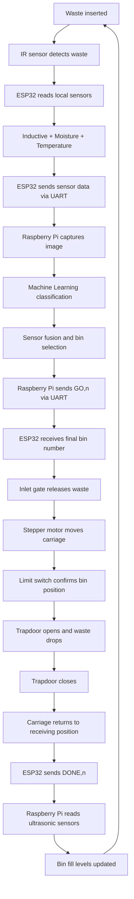

# ♻️ Initially Planned Architecture for Smart Waste Segregation

An intelligent, automated waste segregation system that combines **Machine Learning, Computer Vision, embedded systems, and sensor-based detection** to classify and segregate waste into different categories with minimal human intervention.

The system uses a **Raspberry Pi 4** for image classification and decision-making, while an **ESP32** controls the motors, sensors, and mechanical segregation mechanism.

---

## 🌟 Project Overview

The Smart Waste Segregation System is designed to automate the process of identifying and separating waste. It combines image-based classification with multiple sensors to improve the identification process and directs waste into the appropriate bins using an automated mechanical mechanism.

The system classifies waste into four categories:

- 🔩 **Metal**
- 🌱 **Organic**
- ♻️ **Plastic**
- 📄 **Paper & Cardboard**

## ⚙️ How It Works

The segregation process is divided between two main controllers: the Raspberry Pi and the ESP32.

### 1. Waste Detection and Sensor-Based Analysis

When waste is inserted through the inlet, an **IR sensor** detects its presence and signals the ESP32 to begin the process. The ESP32 then collects additional information using three sensors:

- **Inductive Proximity Sensor:** Detects metallic objects.
- **Moisture Sensor:** Measures the moisture level of the waste, helping identify wet or organic materials.
- **MLX90614 Temperature Sensor:** Measures the object's surface temperature without physical contact and helps identify unusually hot waste.

The ESP32 sends these sensor readings to the Raspberry Pi through **UART serial communication**.

### 2. Image Classification and Decision-Making

The Raspberry Pi captures an image of the waste using the Raspberry Pi Camera Module and processes it using a trained Machine Learning model.

The model classifies the waste into one of four categories: metal, organic, plastic, or paper/cardboard.

The Raspberry Pi combines the camera-based classification with the sensor readings received from the ESP32 to determine the appropriate bin.

Once the decision is made, the Raspberry Pi sends the final bin number back to the ESP32 through UART. For example:

- `GO,1` → Metal bin
- `GO,2` → Organic bin
- `GO,3` → Recyclable bin
- `GO,4` → Fourth bin

### 3. Automated Mechanical Segregation

After receiving the bin number, the ESP32 takes control of the mechanical mechanism.

- **Servo Motor 1 – Inlet Gate:** Controls the entry and release of waste.
- **NEMA 17 Stepper Motor:** Drives the ball-screw mechanism to move the carriage towards the selected bin.
- **A4988 Driver:** Controls the stepper motor's direction and movement.
- **Limit Switches:** Detect the home position and individual bin positions.
- **Servo Motor 2 – Trapdoor:** Opens the shared trapdoor to release the waste into the selected bin and closes it after disposal.

After dropping the waste, the carriage returns to its receiving position, and the ESP32 sends a completion message to the Raspberry Pi.

### 4. Bin-Level Monitoring

Four ultrasonic sensors are installed, one for each waste bin, and are connected to the Raspberry Pi.

They measure the distance between the sensor and the waste surface. The Raspberry Pi uses these readings to calculate the fill percentage of each bin and identify when a bin approaches its capacity.

---

## 🔄 System Workflow

The complete process follows this sequence:

---

## 🔌 Communication Between Controllers

The Raspberry Pi and ESP32 communicate using **UART (Universal Asynchronous Receiver-Transmitter)** serial communication at a baud rate of `115200`.

| Direction | Message | Purpose |
|---|---|---|
| ESP32 → Raspberry Pi | `ITEM,ind,moist,temp` | Sends sensor readings |
| Raspberry Pi → ESP32 | `GO,n` | Sends the selected bin number |
| ESP32 → Raspberry Pi | `DONE,n` | Confirms segregation is complete |
| Raspberry Pi → ESP32 | `PING` | Checks communication |
| ESP32 → Raspberry Pi | `PONG` | Responds to heartbeat |
| Raspberry Pi → ESP32 | `FULL,n` | Reports a bin-full condition |

This architecture separates computational tasks from real-time hardware control, allowing each controller to handle the operations it is best suited for.

---

## 🧠 Controller Responsibilities

| Raspberry Pi 4 | ESP32 |
|---|---|
| Image capture using Pi Camera | Inlet waste detection |
| Machine Learning classification | Inductive sensor reading |
| Sensor fusion and bin selection | Moisture and temperature readings |
| UART communication | Stepper motor control |
| Four-bin ultrasonic monitoring | Servo motor control |
| Bin fill-level calculation | Limit switch monitoring |
| Bin-full notifications | Carriage positioning and segregation |

---

## 🧰 Sensors and Their Functions

| Component | Function |
|---|---|
| IR Sensor | Detects incoming waste |
| Inductive Proximity Sensor | Identifies metallic waste |
| Capacitive Moisture Sensor | Measures waste moisture |
| MLX90614 | Non-contact temperature measurement |
| Raspberry Pi Camera Module v2 | Captures waste images for classification |
| 4 × HC-SR04 Ultrasonic Sensors | Monitor individual bin fill levels |
| 4 × Limit Switches | Detect home and bin positions |

## ⚡ Mechanical and Electrical Components

| Component | Purpose |
|---|---|
| Raspberry Pi 4 Model B (4 GB) | Main processing and decision-making unit |
| ESP32 DevKit V1 | Real-time embedded controller |
| NEMA 17 Stepper Motor | Moves the carriage |
| A4988 Driver | Drives the stepper motor |
| Ball Screw Mechanism | Provides controlled linear movement |
| 2 × Servo Motors (MG90S) | Operate the inlet gate and shared trapdoor |
| OLED Display | Displays system status and messages |

---

## 🏗️ System Architecture

The project follows a **dual-controller architecture**:

- **Raspberry Pi – Intelligence Layer:** Responsible for computer vision, ML inference, sensor fusion, bin selection, and fill-level monitoring.
- **ESP32 – Hardware Control Layer:** Responsible for sensor interfacing, motor actuation, carriage positioning, and automated waste disposal.

This division allows the Raspberry Pi to focus on computationally intensive tasks while the ESP32 handles time-sensitive hardware operations.

---

## 🎯 Project Objective

The primary objective is to develop a low-cost, intelligent waste segregation system that reduces manual sorting, improves waste classification, and supports automated monitoring of waste-bin capacity.

By integrating Machine Learning with embedded electronics and mechanical automation, the project demonstrates a practical application of **AIoT (Artificial Intelligence of Things)** in smart waste management.
