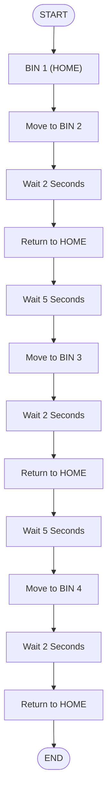

# 🗑️ Testing Codes

This directory contains the testing and validation scripts developed during the **Smart Waste Segregation Project**. These scripts were used for stepper motor calibration, webcam identification, and real-time evaluation of the trained image classification model.

The folder consists of four independent testing programs, each serving a specific purpose in validating different components of the system.

---

## 📂 Contents

| File | Description | Platform |
|---|---|---|
| `RevolutionCount_Of_StepperMotor.cpp` | Stepper motor movement and parameter testing | ESP32 |
| `StepperMotor_FinalizedValues.cpp` | Final motor position validation | ESP32 |
| `find_camera.py` | Identification of available webcam indices | Laptop |
| `RealTime_Classification_through_Webcam.py` | Real-time image classification testing | Laptop |

---

## 1️⃣ RevolutionCount_Of_StepperMotor.cpp

### 🎯 Purpose
This Arduino C++ program was uploaded to the **ESP32** to control the stepper motor and move it by a specified number of revolutions in either the forward or backward direction.

It was primarily developed to experiment with different motor configurations and determine the appropriate movement parameters for the waste segregation mechanism.

### ⚙️ Configurable Parameters

The program allows control over four parameters:

| Parameter | Description |
|---|---|
| **Number of Revolutions** | Specifies the number of revolutions the motor should complete. |
| **Maximum Speed (RPM)** | Defines the maximum rotational speed of the motor. |
| **Acceleration (RPM/sec)** | Determines the acceleration setting during motor movement. |
| **Direction** | Specifies forward or backward motor rotation. |

### 🔬 Testing Objective
- Experiment with different combinations of motor parameters.
- Observe motor movement and positioning.
- Determine suitable speed and acceleration values.
- Identify the required revolutions for positioning the slider at different bins.

---

## 2️⃣ StepperMotor_FinalizedValues.cpp

### 🎯 Purpose
This Arduino C++ program was also uploaded to the **ESP32**. It serves as the final validation and sanity check of the motor parameters established using `RevolutionCount_Of_StepperMotor.cpp`.

After extensive manual testing, hit-and-trial experiments, and evaluating different combinations of the four motor parameters, the following positions and settings were finalized for the four-bin segregation mechanism.

### 📍 Finalized Bin Positions

| Bin | Position from Home |
|:---:|:---:|
| 🟢 Bin 1 (Home) | 0 revolutions |
| 🔵 Bin 2 | 70 revolutions |
| 🟡 Bin 3 | 144 revolutions |
| 🔴 Bin 4 | 217 revolutions |

### ⚡ Finalized Motor Parameters

| Parameter | Final Value |
|---|---:|
| Maximum Speed | **210 RPM** |
| Acceleration | **20 RPM/sec** |

### 🔄 Automated Movement Sequence

The program executes a predefined sequence to verify that the slider accurately reaches each bin position and returns to its home position.

## 3️⃣ find_camera.py

### 🎯 Purpose

This Python script was developed to identify and retrieve the indices of all available camera devices connected to the laptop.

### 💡 Why Was It Required?

During development and testing, multiple webcam devices were available simultaneously due to:

- Integrated laptop webcams.
- External USB webcams.
- Virtual cameras created by different webcam applications.

Consequently, more than 3–4 camera devices could be available at the same time, making it difficult to identify the correct camera index manually.

### 🔍 Functionality

The script scans the available camera indices and helps determine which index corresponds to which physical or virtual camera.

This makes it easier to select the appropriate webcam for subsequent real-time image classification and testing without manually guessing camera indices.

---

## 4️⃣ RealTime_Classification_through_Webcam.py

### 🎯 Purpose

This Python script was developed to evaluate the performance of the trained image classification model using a continuous real-time webcam stream.

Unlike testing individual photographs, this program continuously captures frames from the webcam and passes them through the trained image classification model.

### ⚙️ Working Principle

1. Accesses the webcam connected to the laptop.
2. Continuously captures video frames.
3. Loads the trained image classification model using its `.pth` file.
4. Performs image classification on the incoming webcam frames.
5. Allows the user to observe the model's predictions in real time.

### 💻 Execution Environment

| Component | Details |
|---|---|
| Execution Platform | Laptop |
| Programming Language | Python |
| Model File | Trained `.pth` file |
| Input | Continuous webcam stream |
| Hardware Dependency | Webcam |

### 🔬 Testing Objective

The script operates independently on the laptop and does not require ESP32 integration.

Its primary purpose was to manually observe and evaluate how well the trained model performs under real-time conditions.

It helped assess the model's classification behaviour through continuous webcam input rather than relying solely on predictions from static images, making it useful for preliminary performance evaluation before integration with the complete waste segregation system.

---

## 📌 Summary

These four scripts played an important role in independently testing and validating the hardware and software components of the Smart Waste Segregation Project.

| Testing Code | Primary Contribution |
|---|---|
| `RevolutionCount_Of_StepperMotor.cpp` | Motor parameter experimentation and calibration |
| `StepperMotor_FinalizedValues.cpp` | Final motor position and movement validation |
| `find_camera.py` | Webcam device identification |
| `RealTime_Classification_through_Webcam.py` | Real-time image classification evaluation |

**Together, these testing programs helped establish reliable motor positioning, appropriate webcam selection, and preliminary validation of the trained image classification model before integration into the complete Smart Waste Segregation System.**

---

  <b>Smart Waste Segregation Project</b> 
  Testing • Calibration • Validation

